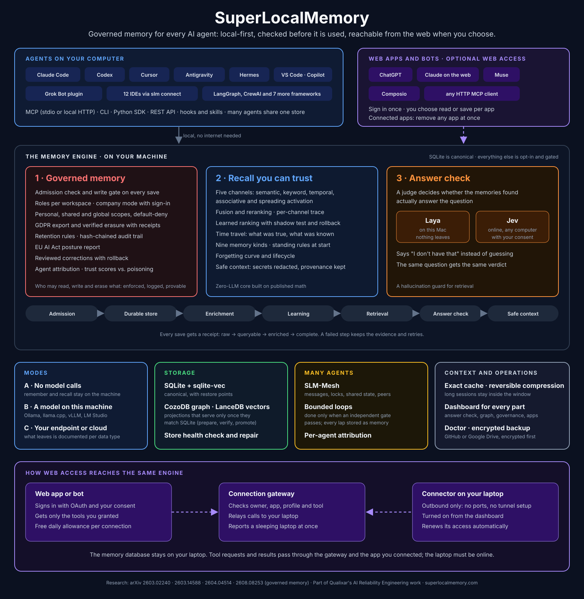

# SuperLocalMemory

**Governed, local-first memory for AI agents.** SuperLocalMemory (SLM) gives your AI agents a memory that lives on your computer, follows rules you set, and can say "I don't have that" instead of guessing. It is the working core of **AI Reliability Engineering**: the practice of making AI systems behave predictably, show their evidence and fail safely.

This wiki is written to be read like a book, front to back or by chapter. It covers the whole product, not just the latest release.

## What SLM is

AI assistants forget everything between sessions, and the memory tools that fix this usually send your data to a service you do not control. SLM keeps the memory in SQLite on your own computer and puts a governed engine in front of it. Agents in Claude Code, Codex, Cursor and other tools talk to that engine through MCP, the CLI or HTTP, and a dashboard shows what it knows and why.

Four ideas set it apart. **Memory is governed**: roles per workspace, default-deny access across profiles, an audit chain you can verify, erasure with a signed receipt, and trust that agents earn and lose. **Recall is honest**: five retrieval producers fuse into one ranking, results with no real evidence are dropped, and every recall says whether memory supports the question, holds only close matches, or does not have it ("That isn't in SuperLocalMemory."). An answer check that runs on your own Mac by default feeds that decision. **Memory behaves like memory**: facts fade, consolidate and connect over time instead of piling up. **It runs where you decide**: nothing leaves your computer unless you turn on a feature that sends it, and [Privacy and Data Flow](Privacy-and-Data-Flow) lists every one.

## Who it is for

Developers who use AI coding agents and want decisions, conventions and fixes to carry across sessions and tools. Teams that need a shared memory with roles, attribution and an audit trail. Anyone who has to show where an AI's answer came from, or erase what it knows. Researchers who want an inspectable memory: the design is published in four arXiv papers, listed at the end of this page.

## Start here

| If you want to | Read |
|---|---|
| Install it and save your first memory | [Installation](Installation), then [Getting Started](Getting-Started) |
| Connect your IDE or agent | [IDE Setup](IDE-Setup), [MCP Tools](MCP-Tools) |
| See the whole system in one picture | [Architecture](Architecture) |
| Understand how a save and a search really work | [How Remember Works](How-Remember-Works), [How Recall Works](How-Recall-Works) |
| Judge whether it is safe for your data | [Privacy and Data Flow](Privacy-and-Data-Flow), [Security, Company Mode and Teams](Security-Company-Mode-and-Teams), [Governance](Governance) |

## What is in the book

**How memory works.** [Architecture](Architecture), [How Remember Works](How-Remember-Works), [How Recall Works](How-Recall-Works), [Retrieval Score Contract](Retrieval-Score-Contract), [Answer Check](Answer-Check), [Memory Kinds](Memory-Kinds), [Modes Explained](Modes-Explained), [Profiles](Profiles), [Auto-Memory](Auto-Memory), [Active Memory](Active-Memory).

**The living system.** [Living Brain](Living-Brain) (decay, consolidation, quantization, learning), [Knowledge Graph, Clusters, Summaries and Entities](Knowledge-Graph-and-Entities), [Skill Evolution](Skill-Evolution), [Health and Repair](Health-and-Repair), [Multi-Agent Memory](Multi-Agent-Memory).

**Governance and trust.** [Governance](Governance) (lifecycle, trust, retention, GDPR, audit), [Security, Company Mode and Teams](Security-Company-Mode-and-Teams), [Privacy and Data Flow](Privacy-and-Data-Flow), [Compliance](Compliance), [Cloud Backup](Cloud-Backup).

**Beyond text.** [Pictures and Documents](Pictures-and-Documents) (screenshots, photos, PDFs, folders and Obsidian vaults), [Ingestion Adapters](Ingestion-Adapters) (Gmail, Calendar, meeting transcripts).

**Connected systems.** [Bots That Talk](Bots-That-Talk) (SLM-Mesh and bot messages), [Web Access and Connected Apps](Web-Access-and-Connected-Apps), [Plugins, Skills and Hooks](Plugins-Skills-and-Hooks) (Claude Code, Cursor, Codex, Copilot, Hermes, Antigravity), [Bounded Loops](Bounded-Loops), [Framework Adapters](Framework-Adapters), [Optimize](Optimize) (caching and compression).

**Operate and reference.** [Dashboard Tour](Dashboard-Tour), [Configuration](Configuration), [Embedding Models](Embedding-Models), [CLI Reference](CLI-Reference), [MCP Tools](MCP-Tools), [Capabilities and Operations](Capabilities-and-Operations), [Troubleshooting](Troubleshooting), [FAQ](FAQ), [Research Foundations](Research-Foundations).

## The product in one list

| Capability | One line |
|---|---|
| Governed storage | SQLite and sqlite-vec as the canonical store, one writer, a journal that replays accepted saves |
| Multi-channel recall | Semantic, keyword, temporal, spreading activation and Hopfield, plus a picture channel, fused and floor-checked |
| Support tiers and answer check | Every recall is supported, related or none; an on-device model (Laya, installed by default on Apple Silicon) or a hosted one (Jev) judges whether results answer the question |
| Layered recall | `depth` 0 to 2, `max_tokens` and `expand` let an agent look cheaply first and drill into one memory |
| Memory health | Older memories are described automatically, repairs that move or delete wait for your Fix, and every run can be undone |
| Living Brain | Decay, consolidation and quantization keep memory fast and relevant |
| Knowledge graph | Entities, edges, clusters, summaries and an Entity Explorer |
| Pictures and documents | Search screenshots, photos and PDFs by what they show |
| SLM-Mesh | Agents and web apps exchange short, safe messages |
| Web access | Optional outbound-only link so ChatGPT, Claude on the web and others use your memory |
| Governance | Roles, trust, retention, GDPR export and erasure, hash-chained audit |
| Optimize | Reversible compression and caching, with no proxy needed |
| Bounded loops | Iteration that ends only when an independent gate passes |
| 110 MCP tools in profiles | `core` 19, `code` 39, `full` 58, `power` 70, `mesh` 9, `whole` 110 |

## The research

SLM's design is described in four arXiv preprints by Varun Pratap Bhardwaj, newest first: [the governed memory operating system paper](https://arxiv.org/abs/2608.08253) (multi-scope isolation, role-based access, verified erasure, hash-chained audit and bi-temporal recall), [the Living Brain paper](https://arxiv.org/abs/2604.04514) (forgetting and cognitive quantization), [the information-geometric foundations paper](https://arxiv.org/abs/2603.14588) and [the privacy-preserving multi-agent memory paper](https://arxiv.org/abs/2603.02240). See [Research Foundations](Research-Foundations).

SLM is open source. The source, issues and releases are on [GitHub](https://github.com/qualixar/superlocalmemory), and the version history is in the [CHANGELOG](https://github.com/qualixar/superlocalmemory/blob/main/CHANGELOG.md).

Pages for older releases, which are no longer supported, are kept in the [Archive](archive/Archive-Index).
