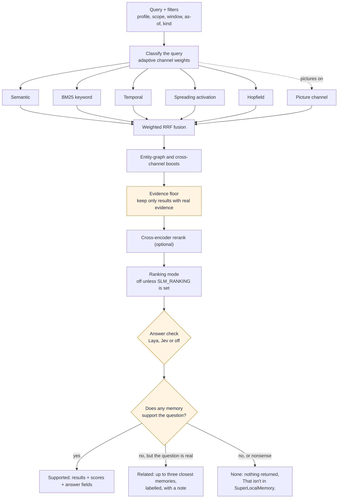

# How Recall Works

Recall answers one question: which stored memories are the best evidence for this query? It is built so that a bad match is dropped instead of dressed up, and so that a person or an agent can tell three situations apart: "I found the answer", "I found something close but not the answer", and "that is not in memory".

## The path at a glance

[Download as PNG](images/recall-flow.png)

Code: `core/recall_pipeline.py` (`run_recall`), `retrieval/support_gate.py`, `retrieval/support_tiers.py`, `core/score_contract.py`, `retrieval/engine.py` (`RetrievalEngine.recall`), `retrieval/fusion.py`, `retrieval/media_channel.py`, `core/answer_check_stage.py`, `core/judge_selection.py`.

## The producers

A query is first classified, and the classification sets the weight each producer gets. Five producers run in parallel, and each reports only if its index is healthy, so a recall degrades to what is available instead of failing.

| Producer | What it matches | Best for |
|---|---|---|
| Semantic | Dense vector similarity | The same meaning in different words |
| BM25 | Keyword match with term weighting | Names, codes and exact terms |
| Temporal | Time references and event order | "What did we decide last Friday?" |
| Spreading activation | Linked neighbourhoods in the graph | Multi-hop related evidence |
| Hopfield | Associative recall over stored representations | Linked decisions and technical context |
| Picture channel | What a picture or PDF page shows | "The slide with the quarterly numbers" |

The picture channel only exists when pictures and documents are on, `media.db` exists and the profile has at least one picture vector. Otherwise it is not even submitted, and a recall is exactly what it was without it. Its query vector comes from a media worker that is already warm, asked at most once and for at most 0.3 seconds. If the worker is cold, it starts in the background, this recall goes on without pictures and says so with a `warming` status. Why: a recall must never wait for a model to load.

The entity graph is not a producer. It scores and boosts fused candidates afterwards, when enabled and within the time budget.

## Fusion, the evidence floor and reranking

The ranked lists are combined with weighted reciprocal rank fusion (k = 15). Fusion rewards agreement between channels without needing their scores to be comparable.

The **evidence floor** comes next, before the optional cross-encoder. A result stays only if it earned real evidence: a semantic cosine of at least 0.60 (a model with its own floor uses that instead, because similarity scores are not comparable between models), or a non-zero BM25, entity-graph or temporal score, or it is a pinned fact. A picture saved with no readable text (a wordless picture) is judged differently, because its other text channels only matched a saving label or a file name: it stays if its picture-channel score reaches the media floor (0.30 by default) or the words of your own note matched by BM25. Such a picture also keeps the position fusion gave it, because a text reranker would only be scoring its label, and the answer check reports it as not judged (`media_unjudged`). Spreading activation and Hopfield do not count as evidence on their own, because they find related material, not matching material. The floor runs before the result limit is applied, so a qualified candidate just below the cut cannot be pushed out by associative hits that the floor would then remove.

If nothing survives, the recall succeeds with an empty list and `abstained: true`, reason `evidence_floor`. If candidate generation finds nothing at all, the reason is `no_candidates`, and the note reads "Nothing in memory matched this question." Neither case involves a judgment about the results; there were none to judge.

The cross-encoder then reorders the qualified pool. It never blocks: with no model loaded, the fused order is returned and the model warms in the background.

## Ranking mode

Learned adaptive ranking is off. Unless you set `SLM_RANKING` to `v1`, `v2` or `v2-ensemble`, recall order comes from fusion and the reranker. An upgrade never turns it on, because a memory system's answers should change when the evidence changes, not because a learned weight drifted.

## The answer check

After ranking, an answer check looks at the top three results and decides whether they actually answer the question. It adds fields and is one input to the support check below; on its own it never hides a result.

| Choice | Where it runs | What leaves your computer |
|---|---|---|
| On this Mac (Laya) | A small on-device model, Apple Silicon only | Nothing |
| Online with Jev | A hosted provider you choose, with your own key and explicit consent | The question and the top memories |
| Off | Nowhere | Nothing |

On Apple Silicon, Laya is installed by default, so for most people on a Mac the check runs unless they opted out ([Answer Check](Answer-Check)). The setting `auto` uses Laya whenever a working install exists, and otherwise stays off. `auto` never resolves to Jev, so data leaves the machine only when someone chose that. For one recall, `answer_check_status` is `judged`, `off`, `skipped`, `busy`, `warming` or `unavailable`. A skipped or unavailable check costs only the verdict. The memories, their order and their scores are unchanged. See [Answer Check](Answer-Check).

## Does any memory support the question? Three tiers

Finding results is not the same as having an answer. A memory made mostly of ids and hashes sits close to almost every question in the embedding space, so a nonsense question used to return something anyway. After the answer check, recall now makes one more decision, the **support check**, and every recall ends in exactly one of three tiers, reported in the `tier` field of the response and on each result.

| Tier | When | What you get |
|---|---|---|
| `supported` | At least one memory carries real support for the question | The supported results, with their scores. Memories that fell short are labelled `weak` |
| `related` | Nothing answers it, but the question reads as a real one and some memories have real evidence for it | Up to three of the closest memories, each labelled related, with the note "I don't have this exactly — here are the closest memories." |
| `none` | The question reads as nonsense, or nothing is close | Nothing, and the note "That isn't in SuperLocalMemory." |

The support check scores each memory on its own, because the evidence has to come from one memory: "v0.3.4 snazzle" finds the v0.3.4 note by its keyword and an unrelated stub by its cosine, and neither alone supports the whole question. The score combines several signals. They are how much closer the memory is to the question than a typical memory is (each memory's own baseline is stored, so ids-and-hashes memories do not get a free pass), how many of the question's words it carries, whether it carries every rare word in the question, the reranker's score, a named entity in common, and whether the question looks like gibberish: its words found in no memory at all, or a pattern that resembles the nonsense questions the check was tuned on. A question with no question word is treated more strictly, because only a memory carrying its words can answer it. Pinned memories are still returned when nothing else is. If a recall had to fall back to keyword search, a memory must carry every rare word of the question and at least half of its content words. Two switches turn all of this off and bring back the older behaviour: the environment variable `SLM_RECALL_NO_SUPPORT_GATE=1` and the setting `retrieval.answer_support_gate` set to false.

**Who sees what.** People and agents get different defaults on purpose. The CLI, the dashboard search and the MCP `search` tool show the related memories, labelled, because a person can judge them. The MCP `recall` tool, which an agent calls, returns only supported results; for a related answer it comes back empty with "I don't have this exactly. Closer memories exist; ask with include_related to see them." and `include_related=true` returns them. Anything is shown with `--show-weak` (CLI) or `show_weak` (MCP and HTTP), which lists the closest weak matches under the note, each labelled `weak`. In the CLI a result line reads `[related]` or `[weak]` after its score. In the dashboard's Memories search, a **Show closest matches** box does the same, and an empty search now says why instead of "No results found." The text shown to the assistant at the start of a session is loading context, not a question, so this check is skipped there.

**Questions about the present, and your own prompts.** A present-tense question such as "What am I working on?" has an answer that shares no word with it, so it skips the word-match test and is answered from your newest memories. Those newest rows on a busy store used to be the hooks' own bookkeeping ("session ended", "File changed") and the prompts you typed to an agent. Bookkeeping is now recognised, flagged when it is saved and left out of answers (nothing is deleted; flagged rows stay listable). Your captured prompts stay searchable but rank as requests: below what you and your agents saved, and never as the answer to "what am I working on?". Ask "what did I ask for..." and they come back first.

**While SLM is warming up.** Right after a start, the embedding model, the reranker or the question probes may still be loading, and then there is nothing to measure. SLM does not say "That isn't in SuperLocalMemory." in that state, because nothing was measured to say it. It returns what keyword search found, up to five results, labelled related, with `warming_up: true` and the note "SuperLocalMemory is still warming up — results may be incomplete. Try again in a few minutes." The same applies when a recall ran without a vector search or without its reranker for any reason. An agent is told to pass that on and not to conclude the memory is absent.

## Many agents at once, and recalls that must be quick

There are two kinds of recall caller, and they get different rules on purpose.

A **question** is anything where someone waits for the answer: the MCP `recall` tool, `slm recall`, `GET /recall`, the Recall Lab and saved views. A question always runs the full pipeline, including a glance at `depth` 0. When other agents are already being answered, it waits for a free slot, up to about twelve seconds. If every slot is still busy, it does not return a keyword guess dressed up as recall. It says "SuperLocalMemory is answering other questions right now. Ask again in about N seconds; nothing was lost." Over HTTP that is status 503 with a `Retry-After` header and `code: RECALL_BUSY`. Over MCP the tool returns `code: RECALL_BUSY` with `retryable: true`. The CLI prints the sentence and exits with code 75. It says nothing about whether the memory exists, so ask again. `session_init`, the first call an agent makes in a session, gets the same full time. It is still never judged by the answer check.

Two identical questions asked at the same moment share one run. A complete answer is reused for 8 seconds, and only while nothing is written: any remember, update, delete, forget or scope change drops it at once, so an agent never reads an answer from before its own write.

A **hook** that adds memories before your prompt is different: it must never hold up typing. It keeps a three-second limit and adds nothing when it runs out. When its full search is still running after about a second, the keyword search starts beside it, and whichever is ready first answers. This is the same for every harness SLM has hooks for. A caller that blocks a turn on recall, such as the Hermes prefetch, can pass `budget_s` to the MCP `recall` tool: recall then answers inside that many seconds, with unchecked keyword matches when the full search cannot finish. Leave it unset for a question.

Background work steps aside for questions: in Mode B, local-model extraction and summaries wait while a recall is running, never more than twenty seconds.

**How fast.** Measured on a real store of 27,000 memories and 16,800 entities, the same 24 questions through the daemon's recall endpoint: median 0.41 s and 90th percentile 0.55 s on an idle machine, and 0.72 s and 0.90 s with three agents recalling at once. While the Mode B language model is working, the median was 2.15 s and the 90th percentile 2.92 s. The answer check ran on all 24 questions. These are one machine and one store, not a guarantee; the speed depends on your store and your computer.

## Layers: depth, max_tokens and expand

An agent rarely needs every memory in full. Recall can be asked for less, or for more around one memory. `depth` takes 0, 1 or 2. Depth 0 is a glance: ids, tier, score and a one-line preview, the cheapest look. Depth 1 is the full facts, which is what recall has always returned and is the default. Depth 2 adds context to each result: the memory it came from, up to three memories from the same session, up to three about the same entities, and the correction that replaced it, if there was one. `max_tokens` caps the whole list and is never exceeded: context is dropped first, then the last memory's text is shortened, then memories are left out, and the response's `layers` field says what was trimmed. When one result looks right, the MCP tool `expand` takes its `fact_id` or `memory_id` and returns the full memory with its depth-2 context, under the same profile and visibility checks as `fetch`. The CLI has `slm recall "question" --depth 2 --max-tokens 800`. Separately, every block of memory text that SLM injects into a session (session start, the context resource, `slm session-context` and the recall hooks) is held to a hard token budget for its mode, cut at a line and marked as cut.

## Scores rank, they do not predict

| Field | Meaning |
|---|---|
| `relevance_score` | Query-relative relevance, bounded 0.0 to 1.0, comparable only within one release and configuration |
| `ranking_score` | Internal utility after reranking or adaptive adjustment; a diagnostic, not a probability |
| `memory_confidence` | Confidence stored with the assertion; not relevance and not answer correctness |
| `trust_score` | Trust signal on the evidence; not answer confidence |
| `rank_position` | One-based position in the returned list |

Every response declares `calibration_status: "uncalibrated"` and `answer_confidence: null` unless an answer check produced a verdict. Do not double, threshold or average these scores into a probability. The full contract is in [Retrieval Score Contract](Retrieval-Score-Contract).

## Asking about time and scope

Recall accepts a time window, `as-of` and `known-as-of` dates, and a `valid-at` date, so you can ask what was true last month or what SLM knew before a given day. Reads default to your own profile; shared and global memories join a recall only when you ask for them or an operator enables the policy. See [Profiles](Profiles).
