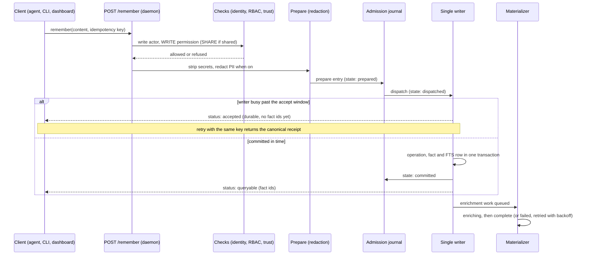

# How Remember Works

This page follows one call to `remember` from the moment a client sends it to the moment the memory is fully enriched. The path is built around one promise: once SLM tells you a memory is saved, it is on disk and can be found, even if the process dies a millisecond later.

## The path at a glance

[Download as PNG](images/remember-sequence.png)

Code: `server/unified_daemon.py` (the route), `memory_core/submit.py`, `core/remember_admission.py`, `core/remember_runtime.py`, `storage/admission_journal.py`, `daemon/materializer.py`.

## Step by step

**1. Every client reaches the same route.** MCP tools, the CLI and the dashboard all end at the daemon's `POST /remember`. A stdio MCP server does not write on its own; it forwards to the daemon (`mcp/_daemon_proxy.py`). That keeps one process in charge of the database, which is what makes the rest of the guarantees possible.

**2. The checks run before anything is written.** The daemon identifies the write actor, routes the call to the right profile, and requires the `WRITE` permission on that profile (and `SHARE` when the memory is shared with other profiles). Only after the permission gate does it tell a caller that a profile does not exist, so an unauthorised caller cannot probe which profiles are there (404 versus 403). The trust policy and the deterministic admission checks also run here. See [Security, Company Mode and Teams](Security-Company-Mode-and-Teams).

**3. The content is prepared.** Text a person typed is stored as written. Text SLM derived itself, such as text read out of a picture, always has credentials stripped. When personal-data redaction is on, it covers every part of the memory, the metadata and the idempotency key. Reserved metadata keys that a caller tries to set are removed so a client cannot forge server-set fields.

**4. The request is written to the admission journal first.** The journal is a separate, encrypted store, and it is not the memory store. It holds a replayable copy of the request and the receipt, and each entry moves through four states: `prepared`, `dispatched`, `committed` or `rejected`. Two writes are fully synchronous to disk: the prepare and the terminal state. The `dispatched` marker is only advisory, because a crash in either state replays the same way. A command can be up to 256 KiB, a receipt up to 16 KiB, and metadata may nest 8 levels deep. Why a journal at all: if the daemon dies between "I accepted this" and "I wrote it", the journal can replay the request on restart, so an accepted save is never lost.

**5. One writer commits it.** The daemon has a single writer for the canonical database. In one transaction it records the ingestion operation, the fact and its full-text-search row. No model work happens inside that transaction. That is why the call can return quickly and why the memory is already findable by keyword when the call returns.

## Receipts: accepted, queryable, complete

| Status you see | What it means | What to do |
|---|---|---|
| `accepted` | The request is durable in the journal but the writer has not committed it yet, so there are no fact ids. | Retry with the same idempotency key. You get the canonical receipt once the commit lands, and the memory is never stored twice. |
| `queryable` | The fact and its keyword row are committed. Recall can find it now. | Nothing. Enrichment continues in the background. |
| `complete` | Every enrichment stage finished. | Nothing. |
| `failed` | An enrichment stage failed. The evidence and checkpoints stay inspectable. | It is retried with bounded backoff. |

The background states are `raw`, `queryable`, `enriching`, `complete` and `failed`. Extraction, entity resolution, consolidation, graph, temporal and embedding work happen while a memory is `enriching`, and which stages exist depends on the [mode](Modes-Explained) and the dependencies installed. A memory that is `queryable` but not yet `complete` is real and searchable; it is only missing its richer indexes.

## Idempotency keys

Every save carries a key, either one you supply or one SLM generates. A key is 1 to 256 characters from letters, digits and `. _ : -`. The key, together with the source type, owns the identity of the save: sending the same key again returns the same receipt, and sending it again with different content is rejected. This is what makes retrying safe after a timeout or a crash.

## Under load

The remember call has a 2,000 ms deadline and answers `accepted` if the writer cannot finish within 1,200 ms. Under normal contention, then, a caller gets a durable `accepted` and never an error. Imports that need the ids before they continue use a settled variant that waits up to 20 seconds, retrying the same key, and then defers its work rather than guessing.

There is one case where a save is refused: when the admission journal's own queue is saturated, or the caller's time budget runs out while queued. Nothing is stored in that case, and the error says so plainly ("too many saves are arriving at once; this one was not saved"). Retrying is safe. A failed disk write is reported separately, with a hint to check free space and that the data folder is writable.

## What does not happen here

In Mode A with the default local models, a save makes no language-model call and does not use the network. Mode B and Mode C add model-based enrichment after the memory is already queryable, and a custom embedding endpoint, if you configure one, receives text during enrichment. See [Modes Explained](Modes-Explained) and [Privacy and Data Flow](Privacy-and-Data-Flow).
