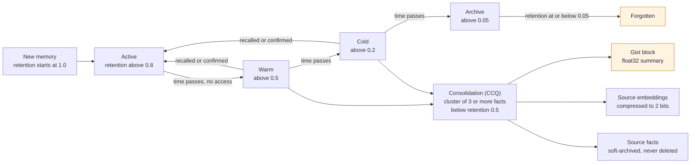

# Living Brain

The Living Brain is SLM's answer to a plain problem: a memory that only grows becomes slower, noisier and less trustworthy. SLM manages memories the way a working memory behaves. Memories that keep proving useful stay sharp, ones that are never touched fade, and clusters of old related facts are folded into a short summary instead of being left to pile up. The ideas come from the paper [The Living Brain](https://arxiv.org/abs/2604.04514) (arXiv:2604.04514), which covers biologically inspired forgetting, cognitive quantization and multi-channel retrieval without an LLM.

The name also covers a dashboard pane called **Brain**. The two parts are different, and this page treats them separately: first the lifecycle machinery, then the Brain pane.

## The lifecycle of a memory

[Download as PNG](images/memory-lifecycle.png)

Code: `math/ebbinghaus.py`, `math/langevin.py`, `dynamics/ebbinghaus_langevin_coupling.py`, `encoding/cognitive_consolidator.py`, `learning/forgetting_scheduler.py`.

### Decay: how strong a memory is

Retention follows the Ebbinghaus curve, `R(t) = e^(-t/S)`, where `t` is the hours since the memory was last accessed and `S` is its strength. Strength grows with how often the memory was accessed (on a logarithmic scale, so the tenth recall matters less than the second), its importance, how many times it was confirmed and its emotional salience. A memory's zone comes from its retention: active above 0.8, warm above 0.5, cold above 0.2, archive above 0.05, and forgotten at or below 0.05. Why a curve and not a timer: two memories of the same age should not be treated alike if one is recalled weekly and the other never.

Forgetting runs on a scheduler, is on by default, and recomputes retention every 30 minutes. A floor on strength (0.1) prevents a brand-new memory from being forgotten at once. Run a cycle by hand with `slm decay`.

When the dynamics layer is on, a memory's lifecycle position is also driven by Riemannian Langevin dynamics. A potential function pulls frequently accessed, important memories toward the centre (active, high retrieval weight) and lets old, unused ones diffuse toward the boundary (archived, weight near zero).

### Quantization: precision follows value

Memory-aware quantization couples retention to embedding precision, so a memory that has gone cold does not keep a full-size vector. It builds on TurboQuant, which rotates a vector and quantizes each coordinate to 2, 4 or 8 bits. Quantization is on by default, keeps a float32 backup, and compacts every 6 hours. Run a cycle with `slm quantize` or the MCP `quantize` tool. Compressed vectors search with a small penalty (0.97) so they rank slightly below full-precision ones.

### Consolidation: many facts, one gist

Cognitive consolidation, called CCQ in the code, works like sleep-time replay. It finds warm and cold facts below a retention of 0.5, groups them by shared entities and nearness in time, writes a short gist, and compresses the source embeddings to 2 bits. The gist is stored at full float32 precision. The code enforces hard rules: a fact that was already consolidated is never consolidated again, a cluster needs at least three facts, the gist must cover at least half of the shared entities, and source facts are soft-archived and never deleted. In Mode A the gist comes from rules; in Mode B and C a model writes it. A light pass runs every 50 stores, and a full pass every 5 sessions, at session end and after 5 idle minutes. Run it by hand with `slm consolidate` or the MCP `consolidate_cognitive` tool.

### Soft prompts: learned habits as plain text

SLM mines recurring patterns from how you work, such as preferences and workflows, and turns them into short text instructions called soft prompts. They are plain text, with no model weights and no fine-tuning. A pattern needs confidence of at least 0.7 and at least five pieces of evidence before it qualifies. List the active ones with `slm soft-prompts` or the MCP `get_soft_prompts` tool.

### Two checks that keep the brain honest

A sheaf-based contradiction check can compare a new fact with the facts it is connected to and record a supersedes link when they conflict. The older memory stays in the store and can still be recalled. The check is off by default (`math.sheaf_at_encoding`, see [Configuration](Configuration)), and it runs at write time only, because an earlier version that ran it at recall time penalised diverse multi-hop results. A Hopfield network supplies one of the five recall producers, finding associatively linked memories; see [How Recall Works](How-Recall-Works).

## The Brain pane

The dashboard's **Brain** pane, the `slm brain` command and the `GET /api/v3/brain` route all show one thing: a read-only, profile-scoped snapshot of what SLM has learned and observed. It reports stored facts, feedback signals, agent-experience receipts, cognitive turns, external evidence from Bounded Loops and correction quality. The snapshot is observation only. Its `control_plane` field is literally `observation_only`, and nothing in it feeds recall, ranking or learning. A measurement that is unavailable comes back as `None` with a reason and never as zero, so the pane cannot imply a number it does not have.

The pane has five tabs: Overview, Reward signal, Behaviour, Connected clients and Source quality.

### Learning phases

Adaptive ranking is off by default and is enabled with `SLM_RANKING`. When it runs, it moves through three phases as feedback signals accumulate:

| Phase | Name | Starts when |
|---|---|---|
| 1 | Cold start (cross-encoder only) | Fewer than 50 signals |
| 2 | Contextual bandit | 50 signals |
| 3 | LightGBM ranker active | At least 200 signals, an active model and a recorded model checksum |

The bandit is contextual Thompson sampling over a fixed catalogue of 40 arms. Signals come from your own recalls and from hooks in coding agents that report how a recalled memory was used. The kill switch is `SLM_BANDIT_DISABLED=1`.

### Maintenance is per workspace

Consolidation, decay, learning and session closing act on one workspace (profile) at a time. A request that names a workspace uses it, a request that names none uses the workspace the caller is signed in to or bound to, and only a caller with neither acts on the machine owner's workspace. The reply says which workspace was acted on. In a team setup that means an administrator of one workspace no longer runs consolidation, decay or a session close against another workspace by accident: the check is made against, and the work runs on, the caller's own workspace, and it needs write permission there. The MCP tools `consolidate_cognitive` and `run_maintenance` do not guess a workspace themselves; the daemon works it out from the caller. If the daemon refuses, the tool reports the refusal and does not quietly run the work on your machine as the owner.

Two kinds of maintenance stay with the whole installation, because they change something shared. `run_maintenance` (`POST /maintenance/run`) needs both management permission on the workspace and installation-wide authority, since its vector-store compaction covers every workspace, while its decay, Langevin and behavioural-pattern steps run on the caller's workspace. Compaction (`slm db compact`) and integrity repair also need installation-wide authority. The computer's owner, or a signed-in administrator of every workspace, has it. A caller without it is told "Your role does not allow changing this setting: it applies to every workspace on this computer, so only the computer's owner or an administrator of every workspace can change it." In personal mode with no team accounts nothing changes for you: the machine operator keeps full access. See [Security, Company Mode and Teams](Security-Company-Mode-and-Teams).

### Commands and tools

| Surface | What it offers |
|---|---|
| CLI | `slm brain`, `slm decay`, `slm quantize`, `slm consolidate`, `slm soft-prompts` |
| MCP | `get_brain_evidence_status`, `record_agent_experience`, `record_cognitive_turn`, `finalize_cognitive_turn` (in `code`, `full` and `power`, not `core`), plus `quantize`, `consolidate_cognitive`, `get_soft_prompts` |
| HTTP | `GET /api/v3/brain`, `GET /api/v3/brain/evolution-timeseries`, `GET /api/learning/status` |

Code: `brain/truth.py` (`BrainTruthService`), `server/routes/brain.py`, `learning/` (`bandit.py`, `ranker.py`, `reward.py`), `mcp/tools_brain.py`, `mcp/tools_v33.py`, `parameterization/soft_prompt_generator.py`, `core/config.py` (`ForgettingConfig`, `QuantizationConfig`, `CCQConfig`, `ConsolidationConfig`, `ParameterizationConfig`).
