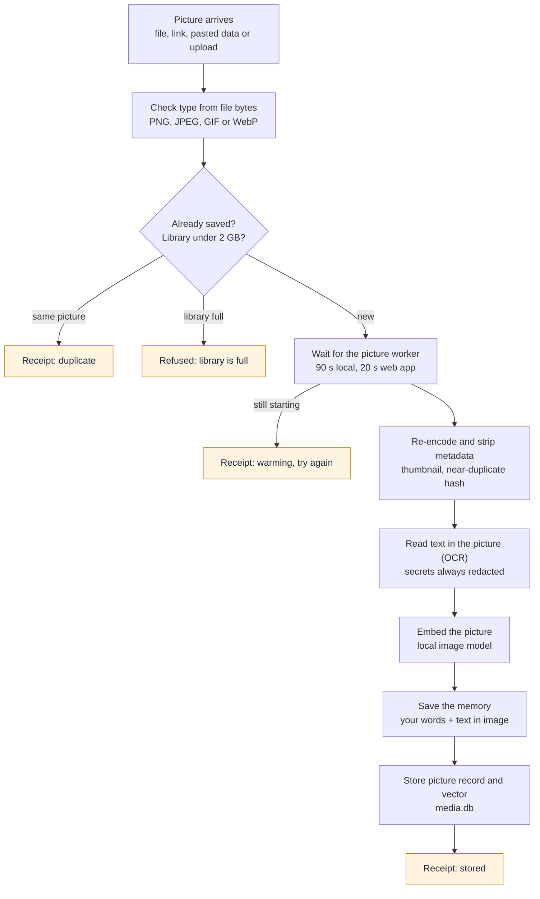
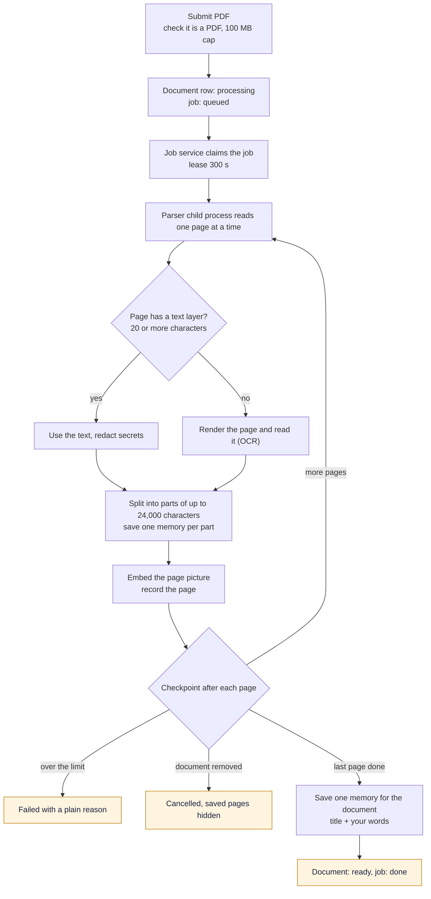
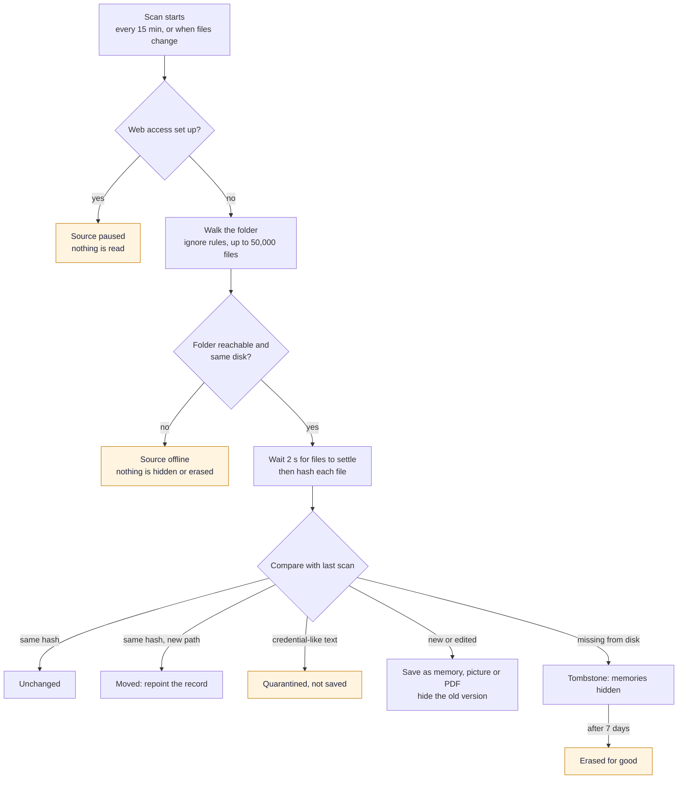

# Pictures and Documents

SLM can remember screenshots, photos and PDFs and find them later by describing what they show: "the slide with the quarterly numbers", "the error dialog from the deploy". A picture model (Google's EmbeddingGemma 2) runs on your computer, OCR reads the text inside pictures, and each PDF page is indexed by both its picture and its text. No generative model looks at your files. The feature is off until you turn it on, and turning it on does not touch your existing memories or their embeddings: pictures and pages are added next to them, in their own database.

Text keeps its own model, so turning this on never changes how your text is searched ([Embedding Models](Embedding-Models)).

Turn it on in the dashboard (**Documents & Images**), in the npm installer or upgrader, or with `slm media enable`. The first time, it downloads about 1.5 GB of models and tools into SLM's own folder.

## What your computer needs

| | |
|---|---|
| Memory (RAM) | 16 GB minimum. Computers sold as 16 GB report a little less, so the check passes from 15 GiB. |
| Disk | About 1.5 GB for the models, plus what you save (up to 2 GB per profile). |
| Systems | macOS on Apple Silicon, Windows x64, Linux x86_64 and Linux ARM64 (aarch64) with a glibc such as Debian, Ubuntu or Fedora. Python 3.12, 3.13 or 3.14. |
| Not supported | Windows on ARM and Intel Macs. Text memory works there as before. |

Below 16 GB the switch is refused with the reason, because the picture model and a large PDF together can push a smaller machine into swapping. Your text memories keep working. If you accept that risk, set `SLM_MEDIA_ALLOW_LOW_RAM=1` in the environment SLM starts from and turn the feature on again; SLM logs a warning each time.

## Saving a picture

[Download as PNG](images/picture-save.png)

Code: `media/ingest.py` (`remember_media`), `runtimes/worker_client.py`, `runtimes/media_image_ops.py`, `runtimes/multimodal_worker.py`, `media/store.py`, `mcp/tools_media.py`.

Five callers reach this path: a local agent through the `remember_media` tool, a web app through Web access, a dashboard upload, an upload link and a connected folder. They share the same checks and differ only in limits. The type is decided from the file's first bytes, never from its name. The picture is re-encoded, which strips its metadata, and a thumbnail and a near-duplicate hash are made. Why re-encode: location and device details in a photo's metadata are never read or kept, so they cannot leak later. A GIF is stored as its first frame.

OCR runs on this computer. Turning images and documents on installs RapidOCR with the other picture packages. On a Mac, OCR tries Apple Vision first and RapidOCR when Vision is missing or finds no text. On other systems it uses RapidOCR, with the models bundled in that package. If the package cannot be imported, or those models are missing, OCR is skipped and the picture is still saved. Text read from a picture is treated as derived text, so credentials in it are always redacted before it is saved. The memory is then your own words plus the text found in the picture, or a short "image without text" label if there was none.

A first save can find the picture worker still loading its model. A local caller waits up to 90 seconds and a web app up to 20, because a web app's call has a 25-second budget. If the worker is still not ready the receipt says `warming` and you retry in a minute. The same picture saved twice returns `duplicate`; a picture within 4 bits of an existing one's hash is saved and flagged as a near duplicate, not refused.

## Saving a PDF

[Download as PNG](images/pdf-pipeline.png)

Code: `documents/submit.py`, `documents/runner.py` (`DocumentJobService`), `documents/pipeline.py` (`JobRunner`), `documents/parse_proc.py`, `runtimes/pdf_parse.py`, `documents/chunking.py`.

A PDF is queued, not processed inside your call, so a 300-page document does not hold anything up. A background job reads it one page at a time in a child process, using the text layer when a page has one (20 or more non-space characters) and OCR on the rendered page when it does not. Each page becomes one or more memories, and the document gets one memory of its own with its title and your words. After every page the job checks whether to stop: if the daemon is shutting down it releases the job to resume later, if you removed the document it hides what was saved, and it yields briefly so a recall is never starved. Because pages already recorded are skipped on restart, an interrupted job resumes and never saves a page twice.

A PDF that cannot finish is marked failed with a plain-language reason: password-protected, too many pages, a page that took too long, or the reader hit its memory limit. Pages read before it stopped stay in your memory, and removing the document hides them too. Dropping the same file again retries it.

## Limits

| What | Limit |
|---|---|
| Picture formats | PNG, JPEG, GIF (first frame) and WebP |
| One picture | 25 MB from a file, the dashboard or an upload link; 8 MB as pasted data in a tool call; 512 KB from a web app's pasted data |
| One PDF | 100 MB (change with `SLM_DOC_MAX_MB`); 25 MB as pasted data in a tool call |
| PDF pages | 500 (`SLM_DOC_MAX_PAGES`). A longer PDF is refused as a whole, not cut short. |
| Reading a PDF | 30 seconds per page and 20 minutes per document; the reader is stopped past 1.6 GB of memory |
| Text kept per page | 1,000,000 characters; each memory part holds up to 24,000 |
| Picture and text reader memory | Checked twice a second while a request runs: past 4.5 GB the reader is stopped, that request fails with a plain message, and the next one starts a fresh reader. On Linux the reader also starts with a hard limit above that. Text over 8,000 characters, a picture file over 25 MB or a picture with more than 50 million pixels is refused before it is sent |
| Library | 2 GB of pictures and PDFs per profile |

## Folders and Obsidian vaults

A connected folder (or an Obsidian vault) is read, never written. You pick a folder, SLM shows a preview of what it would read, and nothing is saved until you confirm. The scanner then mirrors Markdown, text, PDFs and pictures into memory, and rescans every 15 minutes or when files change.

[Download as PNG](images/folder-reconcile.png)

Code: `sources/reconcile.py` (`scan_source`), `sources/scanner.py` (`SourceScanService`), `sources/ingest.py`, `sources/retire.py`, `sources/api.py`, `sources/ignore.py`.

Several of these behaviours exist to protect you. An unreachable drive, a different disk or an empty folder marks the source offline and hides nothing, so unplugging a drive cannot wipe your memories. A text file that looks like it contains a credential in its first 256 KiB is quarantined instead of saved, until you release it. A file that disappears is hidden at once and erased for good only after 7 days; a replaced version is hidden at once and erased after 7 days too. Cloud-only placeholder files are never read. A folder holds up to 50,000 files, and text up to 5 MiB, PDFs up to 50 MiB and pictures up to 25 MiB each.

**Folders and Web access do not run together.** While Web access is set up, every folder source is paused and a new one cannot be connected, and remote apps can never see folder content. Files found while pictures and documents were off are listed as skipped and are read on the next scan once the feature is ready.

Removing a source hides everything it gave by default. `slm sources remove ID --purge` erases it through the same GDPR erasure path as a normal forget, and fails loudly with `erasure_incomplete` rather than claiming success if any copy remains.

## Seeing pictures from a web app

A web app connected through [Web Access](Web-Access-and-Connected-Apps) never sees folder content, and it sees a picture only when three things hold: the picture was vetted as safe to share (its OCR text contained no secrets and no personal data), the app has the media permission, and the picture is in the app's one bound profile. A remote app gets the thumbnail, not the original.

A web app can save a picture or PDF in two ways. ChatGPT can hand over an attached file, which your computer downloads only from ChatGPT's own file hosts plus any host you add to `SLM_MEDIA_URL_HOSTS`. Any app can ask for a one-time upload link; see [Web Access and Connected Apps](Web-Access-and-Connected-Apps#one-time-upload-links). Saving remotely needs the media permission and a write key.

## Commands

| Command | What it does |
|---|---|
| `slm media enable` | Shows the download size and a disk check, then asks; `--yes` skips the question |
| `slm media status` | What is on and how set-up is going |
| `slm media disable` | Turns it off; memories are kept (`--remove-files` also deletes the downloaded models) |
| `slm media gc` | Reports picture records whose memory is gone, files with no record and pictures not yet linked; `--apply` fixes them. It never deletes a memory and only touches stored picture files |
| `slm media repair` | Re-reads kept pictures into the current picture index, after a model change or a "can't be found by what it shows yet" message; `--dry-run` only counts them |
| `slm sources add PATH` | Connects a folder or Obsidian vault after a preview and your confirmation |
| `slm sources list`, `report`, `rescan`, `remove` | Manage connected folders |

After `enable`, restart SLM (`slm restart`, or the dashboard button) so the picture worker starts. `enable` also starts SLM if it is not running.

## Exports and erasure

`slm gdpr export` adds a `media` section with records only: type, size, dimensions, capture time, scope and state for each picture, document and folder. It carries no picture or document bytes and no thumbnails. The memory export carries the text of pictures, pages and folder files as ordinary memories with a `source` field. Removing a document hides its pages, and a hard removal erases them through the GDPR path. Cloud backups never include `media-*.db`, so pictures and documents stay on this computer.
