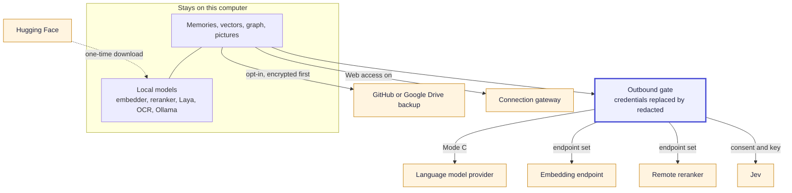

# Privacy and Data Flow

This page answers one question for every feature: what stays on your computer, and what can leave, to where, and under whose control. SLM is local-first, which describes where the core memory state lives. It does not mean every optional feature is offline, so each feature that can send data is listed here with the setting that controls it.

## The map

[Download as PNG](images/privacy-map.png)

Code: `core/outbound_http.py`, `core/outbound_redaction.py`, `retrieval/hosted_redaction.py`, `core/modes.py`, `infra/cloud_backup.py`, `remote_connections/companion.py`.

## The one gate

Every request that carries memory text to another host passes one outbound gate (`core/outbound_http.py`). A destination on this computer (loopback) gets the text as written, directly, never through a proxy. Any other destination gets every string passed through credential redaction first, which replaces API keys, tokens, passwords in connection URLs and values after credential labels with a bare `redacted` marker. Nothing about the original survives, not its length, prefix or type. Redirects are never followed.

Two limits matter. The gate screens credential shapes only: it does **not** redact personal data such as email addresses or phone numbers, with one exception, the remote reranker, which also strips personal data. And it does not touch stored memories, results returned to a local caller, or memory text returned to a remote app. Stored memories keep credentials as you wrote them, and the opt-in `SLM_PII_REDACTION` is the control for personal data on disk.

## By feature

| Feature | Stays on this computer | Can leave | Controlled by |
|---|---|---|---|
| Remember and recall, Mode A | Everything. No language model is used to save or recall. Embeddings, reranking and extraction are local (the optional on-device answer check is listed separately) | Only if you set the embedding provider to an OpenAI-compatible endpoint, or Ollama on another host. Then the text being embedded goes there | The mode and the embedding provider setting |
| Remember and recall, Mode B | Text, queries and prompts, while the model is on this computer (Ollama on localhost by default) | If the model server or Ollama is on another machine, prompts go there, credentials redacted | The mode and the LLM and embedding provider settings |
| Remember and recall, Mode C | The database, vectors and graph | Memory text in extraction prompts at save, the query and top candidates during recall refinement, and answer prompts go to your provider (default OpenRouter; also OpenAI, Anthropic, Azure or your own). Credentials are redacted; personal data is not | The mode, provider, endpoint and key |
| Answer check, Laya | The question, the memories and the verdict. It runs in a local worker and is forbidden from using the network at run time | Nothing at run time. The one-time setup downloads the model and package | `sufficiency_judge` (`auto`, `laya`, `jev`, `off`) |
| Answer check, Jev | The database | The question and the top 3 memories (up to 1,800 characters each), one request per recall, never retried, to the Jev provider you chose (TypeSafe or OpenRouter) | `sufficiency_judge = jev`, **and** a consent flag that is literally true, **and** a stored key. `auto` never selects Jev |
| Jev reorder | The database | In addition to the above, up to 20 memories (range 5 to 30), each cut to 1,200 characters, in one request capped at 40,000 bytes | Jev chosen, **and** its own separate consent. Turning Jev off or removing the key clears both |
| Pictures: OCR and embedding | The re-encoded picture, thumbnail, hash, vector and OCR text. OCR and embedding run locally | Model weights are downloaded once at setup. OCR text becomes memory text and then follows the normal pipeline, so in Mode B or C it can reach your model like any other memory | The Documents & Images switch (needs 16 GB RAM) |
| Folder sources | Files are only read, never written. Text and hashes stay local | Through the normal pipeline like any memory. Never to remote apps | A preview and your confirmation per folder |
| Web access | The database and vectors | Answers to the apps' calls (the key's one bound profile), mesh messages with secrets redacted, vetted picture thumbnails and upload bytes, over one outbound link | The Connected apps page, per-app permissions, per-key abilities |
| Cloud backup | The live database and plain local backups | Encrypted copies of `memory.db` and companion files, never `media-*.db`, to a GitHub release or Google Drive | Adding a destination (opt-in) |
| Embedding providers | With the default local model, everything | The text being embedded, to the endpoint you set. Credentials redacted unless it is on this computer | Provider and endpoint settings |
| Memory-kind typing | Rules-based typing is local and always on | With the `jev` backend only: batches of 8 memories during a "Classify my memories" run | `memory_kinds.json`, and Jev consent. `auto` never resolves to Jev |
| Ingestion adapters | Fetched content is posted to the local daemon | Gmail over IMAP or the Gmail API, and Calendar over its API, are network connections you configure. Mbox, ICS and transcript folders are local | Per-adapter opt-in |
| Optimize proxy | Cache and metrics in a local store | Your client's own requests, changed only by the cache and compress hooks and by the outbound gate (credential-shaped text in the body is replaced), to the provider that client already uses | `proxy_enabled`; the client must be pointed at the proxy |

## What "nothing leaves this device" means

The Mode A description reads "Memories are saved and recalled without a language model — nothing leaves this device." That is true with the default local embedder and no optional features turned on. It is a statement about SLM's default configuration, not a flag that blocks the network: the mode capability flags in the code are descriptive, and what actually leaves depends on the endpoints you configure. If you point Mode A's embedding provider at a remote endpoint, text goes there. Check the provider settings, not only the mode.

## Hosted redaction in detail

Credential redaction uses high-aggression secret detection and then collapses every marker to the same bare token, so a redacted value tells the receiver nothing. If a question or memory is empty after redaction, SLM refuses to send it rather than sending a blank. The Jev answer check, the Jev reorder, memory-kind typing by Jev, every model and embedding request to a non-local host, the skill evolution prompts and the remote reranker all use it. Mesh messages from web apps use the same detection at send and at read.

## Telemetry

When this page was written we found no analytics client and no sender of usage telemetry in the code. The only metrics surfaces are local: a read-only learning telemetry route and an optional Prometheus or OpenTelemetry exporter that you turn on yourself. Raw proxy traffic is captured to a local file only if you set `SLM_OPTIMIZE_CAPTURE`.

## Erasure, exports and the GDPR controls

Erasure covers more than the main database: it removes or withholds the summaries, persona, scene titles, core blocks, soft prompts and entity text that quote an erased memory, scrubs derived caches and tracks backup copies as an obligation. A restore never brings erased data back ([Cloud Backup](Cloud-Backup)). See [Governance](Governance#compliance) for the export, erase and verify commands.
