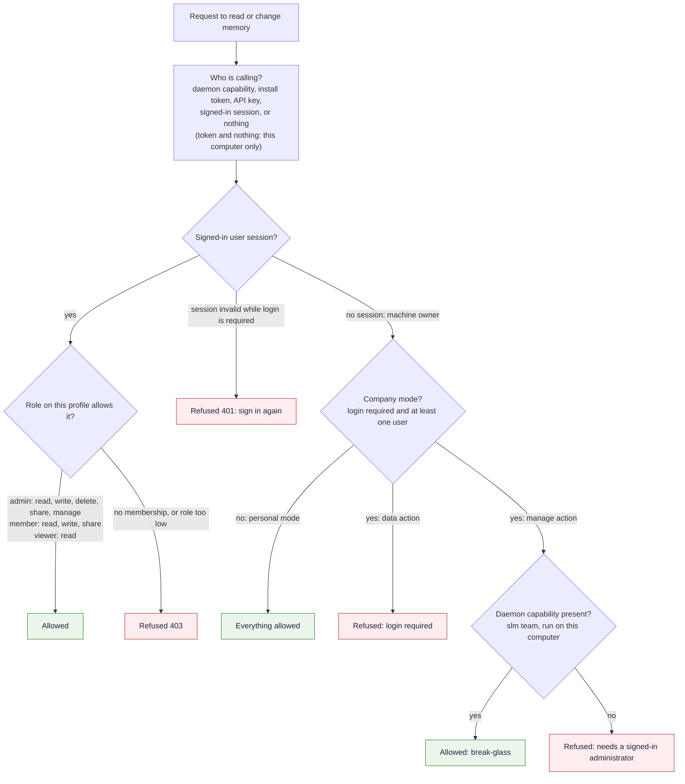

# Security, Company Mode and Teams

SLM answers two separate questions on every request that reads or changes memory. The first is **who is calling**, which is a matter of credentials. The second is **what that caller may do**, which is a matter of roles. This page covers both, then company mode, which is the setting that turns a single-user memory into a shared, attributed workspace.

## Who is calling: credentials

| Credential | Where it comes from | Rule |
|---|---|---|
| Daemon capability | A private file in the data folder, mode 0600, never served over HTTP. The CLI attaches it. | The strongest local credential. Compared in constant time. |
| Install token | Embedded in the dashboard | Accepted only from this computer (loopback) |
| API key | `X-SLM-API-Key` header | Reaches the network. Not authority to administer a company workspace |
| Dashboard user session | A cookie or `X-SLM-User-Session` | 12-hour life, token stored only as a SHA-256 hash, passwords hashed with scrypt, at least 8 characters |
| Remote key | A web app through Web access, or a computer on your network | Bound to one profile, scope `read` or `write`, optional `mesh` and `media` abilities |
| Nothing | A request from this computer with no credential | Allowed only from loopback, and not at all when `SLM_REQUIRE_CREDENTIALS=1` |

A request from another machine with nothing valid is refused with a 403 that lists the accepted credentials. Why the install token is loopback-only: it ships inside the dashboard page, so it must never be useful to someone who is not already on the machine.

## What the caller may do: roles

Roles are granted per workspace (profile), and a role in one workspace grants nothing in another.

| Role | Read | Write | Delete | Share | Manage users |
|---|---|---|---|---|---|
| `admin` | yes | yes | yes | yes | yes |
| `member` | yes | yes | no | yes | no |
| `viewer` | yes | no | no | no | no |
| no membership | no | no | no | no | no |

The decision order is the same everywhere in the daemon.

[Download as PNG](images/access-decision.png)

Code: `server/write_identity.py`, `server/rbac_enforce.py` (`require_permission`), `access/rbac.py`, `server/routes/rbac.py`, `cli/team_cmd.py`.

Two details matter. A session token that does not resolve while login is required is refused with a 401 and is never silently treated as the machine owner. And if the system cannot read the roles table, it answers 503 and asks you to retry. It never promotes the caller.

## Personal mode and company mode

By default SLM is single-user: whoever runs it owns it, and there is no login. **Company mode** turns that off and requires every operation to be attributed to a named person with a role on that workspace. It is on when login is required **and** at least one user exists. An unreadable policy counts as strict, not as off. Turn it on only when more than one person shares a store.

**Setting it up.** In the dashboard, open **Settings, Access** (also **Governance, Access & Users**). Add users, give each a role on the workspace, then turn on "Require login". The same operations exist over HTTP (`POST /api/rbac/users`, `/api/rbac/members`, `/api/rbac/policy`, and `GET /api/rbac/status` to confirm it took effect), and `slm team status` and `slm team policy --require-login on|off` run on the SLM computer.

**Who administers.** Once users exist and login is required, the install token or an API key alone no longer administers the workspace, because any local program could fetch the token. Administration needs a signed-in admin, or the daemon capability from the command line. That is the break-glass: `slm team` runs on the SLM computer with the capability, so a workspace's owner can never be locked out by a mistake in the user list. Why: enabling company mode with an error in it would otherwise lock everyone out of a machine they have shell access to anyway.

**Installation-wide actions.** Some settings and operations affect every workspace on this computer at once, so management of one workspace is not enough for them. They need the computer's owner (in personal mode, or with the daemon capability in company mode) or a signed-in user who administers every workspace. These include: the login policy, the memory-kind settings, the operating mode and provider, the embedding engine, Optimize, the answer-check settings, turning pictures and documents on or off, the scope, auto-capture, auto-recall and other global configuration, maintenance runs and compaction, integrity repair, backup, recovery and restore, connecting IDEs and local apps, ingestion adapters, and turning skill evolution on or off. Day-to-day work in a workspace needs only that workspace's role: writing and consolidating need write permission there, and running skill evolution, approving a candidate or rolling one back needs manage permission there. A caller who lacks the authority is told: "Your role does not allow changing this setting: it applies to every workspace on this computer, so only the computer's owner or an administrator of every workspace can change it." Each person signed in also has their own active workspace, and a request that names none acts on it, not on the machine owner's. See [Living Brain](Living-Brain) and [Skill Evolution](Skill-Evolution).

**AI tools in company mode.** An assistant connects without a browser or cookie, so it cannot say who is calling, and its writes are refused while reads are unaffected. To let a tool write, start it with `SLM_USER_SESSION` set to a session token from `POST /api/rbac/login`. The write is then attributed to that user and checked against that user's role; a viewer still cannot write. If the variable is unset or expired the write is refused, not treated as the owner's.

**Web access is off in company mode.** Remote keys are refused while login is required, so a web app cannot bypass the login gate. See [Web Access and Connected Apps](Web-Access-and-Connected-Apps).

**What company mode does not do.** It is not encryption: anyone who can read the database file can read the memories, because company mode governs access through SLM and not access to the disk. It does not partition a workspace between users, so everyone with a role on a workspace sees all of it, and separate workspaces are the unit of separation. And it does not reach a second machine, because users and roles live in the store.

## Protecting the data on disk

The data folder is owner-only (`0700`) and every database file and its sidecars are `0600`. SLM does not encrypt the database itself by default. The primary control is full-disk encryption (FileVault, LUKS or BitLocker), because an application-level key would have to live on the same machine and would mostly repeat what the disk layer already does, at the cost of extra dependencies. Cloud backups are different: every file is AES-256-GCM encrypted on your computer before it leaves, with a per-machine key kept in the OS keychain; see [Cloud Backup](Cloud-Backup).

**Credentials you save are stored as written.** SLM keeps the keys, tokens and passwords you save, so an agent can recall them later, and nothing is stripped on save. Credentials are always redacted on the way out to any non-local host (see [Privacy and Data Flow](Privacy-and-Data-Flow)), and the opt-in `SLM_PII_REDACTION` scrubs emails, phone numbers and similar identifiers before they reach disk.

**A shared Mac.** The service listens on this computer's local address and, in a personal install, trusts every request from this computer, including programs run by another account on the same Mac. A web page on another site cannot reach it: requests whose `Host` header is not an alias of this computer (or a name you configured) are refused, browser cross-origin requests are allowed only from the daemon's own origin (the same rule applies to the dashboard's live-update WebSocket), and the endpoint that hands the dashboard its token never grants cross-origin access. A per-account check is not in this release. On a shared computer, prefer a Mac you do not share, or turn on company mode.

## Trust and rate limits

Agents also earn or lose trust; see [Governance](Governance#trust). Writes and reads are rate limited per window. The base limits are 30 writes and 120 reads per 60 seconds, set with `SLM_RATE_LIMIT_WRITE`, `SLM_RATE_LIMIT_READ` and `SLM_RATE_LIMIT_WINDOW`, and requests from this computer get a higher ceiling derived from them. The dashboard's Rate Limits setting can change them without a restart.

Code: `access/rbac.py`, `server/rbac_enforce.py`, `server/write_identity.py`, `core/security_primitives.py` (`harden_db_perms`), `infra/auth_middleware.py`, `trust/gate.py`.
