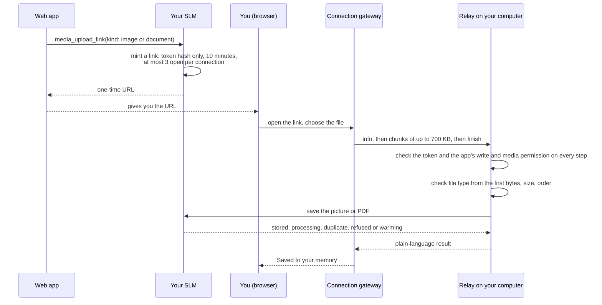

# Web Access and Connected Apps

SLM works fully on your computer. **Web access** is an optional extra for one purpose: letting an AI app that runs on the internet, such as ChatGPT, Claude on the web, Composio or Muse, recall from and, if you allow it, save to the same memory your local agents use. It is off until you turn it on, and it only turns on when you approve an app. Your database never leaves your computer: an app asks your computer a question and gets an answer back.

## How the connection works

Your computer opens one outbound link to a connection gateway. There is no tunnel to configure, no open port and no account to create beyond a GitHub sign-in. A web app talks to the gateway, the gateway relays each call down your link, and your computer answers it from the local engine. If your computer is asleep or offline the app gets `connector_asleep`, never an empty result that looks like a real answer.

Each relayed call carries a grant signed by the gateway that names what the app may do, and your computer verifies it before running anything. Credentials are kept in your operating system's secure store, never in the browser. A relayed request is limited to 1 MiB, a response to 4 MiB, and a call has a 25-second budget. Your computer takes up to 8 web requests at a time and answers `connector_busy` (HTTP 429) beyond that.

The local core never needs any of this. Claude Code, Codex, the CLI, SLM-Mesh and the answer checks all run without Web access, and a problem in the connection never stops local SLM from starting.

## What you need

SLM installed and running on a computer that stays on and online while the app needs your memory. A GitHub account, used only to sign in to Web access. An app that supports a custom remote MCP connection with OAuth sign-in; whether your plan with that app allows one is up to the app.

## Turn it on

1. Open the dashboard (`slm dashboard`) and choose **Connected apps** under **Integrations**.
2. Under **Set up an app**, choose the app: ChatGPT, Claude (web), Claude Code (web), Composio, Muse or **Other app (MCP)**. The choice only picks which instructions are shown.
3. Under **What this app can do**, tick **Turn on internet access for this app**, and choose whether it may save memories and use session tools.
4. Select **Link this computer with GitHub** and finish the sign-in. Wait for **Web access is on**.
5. Add SuperLocalMemory to the app. Most apps ask only for the MCP server URL; some also ask for the OAuth metadata URL. Both are shown on the page under **Technical details**. Sign in with the same GitHub account when the app asks, and approve its permissions.
6. Paste the text from **Copy instructions** into the app's instructions, so it knows when to recall and what to save. Connecting gives an app the tools, not the judgment to use them well.
7. Ask the app something your memory knows. Only a completed round trip proves the connection works.

The page reaches one memory profile, the one active when you turn Web access on. Switching profile clears an unfinished sign-in and resets the permission boxes.

## What an app can do

| Permission | What it allows | Tools |
|---|---|---|
| Read (always on) | Look things up | `recall`, `search`, `fetch`, `get_status` |
| Save | Remember new things | `remember` |
| Session tools | Open and close sessions, report whether a memory helped | `session_init`, `close_session`, `report_feedback`, `report_outcome` |
| Mesh | Message your other bots | `mesh_peers`, `mesh_send`, `mesh_inbox`, `mesh_wait`, `mesh_state` (see [Bots That Talk](Bots-That-Talk)) |
| Pictures and documents | Save and read pictures and PDFs | `remember_media`, `get_media`, `remember_document`, `media_status`, `media_upload_link` (see [Pictures and Documents](Pictures-and-Documents)) |

Saving and session tools are separate choices and are off unless you tick them. Mesh and media each need a second yes, a switch on the **Web access** row of Connected apps, in addition to the app's own approval. An app can never delete, retire or correct a memory, share one with another profile, switch profile, or run any other tool; those stay on your computer. Host-only tools are always refused to a remote caller. **Remove access** ends one app immediately, and **Turn off** ends Web access for every app at once, with your memory untouched.

Anything an app reads is shared with that app and the AI service behind it, and anything it saves travels to your computer through the link. Memory text returned to an app is whatever is stored for that key's one bound profile, with host details such as paths, your home folder and account names withheld. Treat it like any other service you give access to.

## One-time upload links

An app cannot reach a file on your computer, and you cannot paste a PDF into most chat boxes. So an app asks SLM for a one-time link, hands it to you, and you open it and choose the file.

[Download as PNG](images/upload-link.png)

Code: `mcp/tools_media_upload.py`, `media/upload_links.py`, `remote_connections/upload_relay.py`, `server/routes/media_upload.py`, `server/remote_tool_policy.py`.

A link belongs to the app that asked for it and works for one file. It must be started within 10 minutes, and the upload must finish within 20 minutes of starting. A connection can have 3 open links and start 20 uploads a day, and each link allows 3 attempts. The file travels in chunks of up to 700,000 bytes and is checked on your computer, from its first bytes, for the kind of file the link was made for. The link's token is verified on your computer, which stores only a hash of it; the gateway relays the chunks and never holds the capability check. Treat a link like a password for one upload: anyone who has it before it is used can save one file into your memory. If the picture tools are still starting when the upload finishes, the page says so and you send the file again a minute later.

## When it is not available

| What you or the app sees | Meaning |
|---|---|
| `connector_asleep` | Your computer is asleep or offline. Wake it and the app can try again |
| `connector_busy` | More than 8 web requests at once (HTTP 429). One at a time is enough. The project's older error guide calls this `relay_busy` |
| `relay_timeout` | A call passed its 25-second deadline |
| `DAILY_LIMIT_REACHED` | The free daily allowance is spent; it resets later. Local use is never limited |
| `REVOKED` or `ENTITLEMENT_REQUIRED` | Web access has ended or the app was removed |

## Renewal

Your computer's credential renews itself, so normally you do nothing, and the page shows **Renews automatically**. If renewal keeps failing and fewer than 7 days remain, the page says when Web access ends and asks you to check that the computer is online. **Web access has ended** means you turn it on again; **Sign in again to keep Web access working** means the GitHub sign-in lapsed. Each app's own sign-in also lapses after a period without use, and the app then signs in again.

## Rules that limit it

Folder sources pause while Web access is set up. Pictures saved by an earlier release are held back from web apps until saved again, because they were vetted under an older rule. See [Security, Company Mode and Teams](Security-Company-Mode-and-Teams) and [Privacy and Data Flow](Privacy-and-Data-Flow).

## Other computers on your network

A different feature, `slm remote`, serves other computers on your network or tailnet, with no cloud involved. It is a second, TLS-only listener, off by default. `slm remote tls init` makes a certificate, `slm remote enable --listen HOST:PORT` turns it on, and `slm remote keys add NAME` creates a named key, shown once and bound to exactly one profile (`--read-only` for a read-only key). The listener serves `/mcp` and any path under it (a bare `/mcp` is served as `/mcp/`), plus `GET` and `HEAD /health`. Any other path is 404. Company mode refuses these keys: an enterprise deployment, or a workspace that requires sign-in. If that mode cannot be read, the keys are refused as well. `slm remote keys allow NAME mesh|media` grants the optional abilities, and `slm remote check` tests the setup.

Web access is not database replication and not SLM-Mesh. More guides are in the repository under [docs/remote-access](https://github.com/qualixar/superlocalmemory/tree/main/docs/remote-access): connecting each host app, the architecture and trust boundaries, and how to check a connection end to end.
